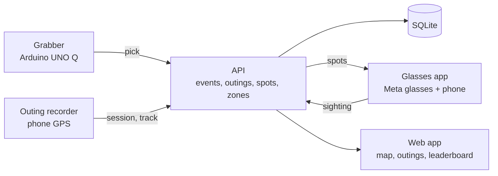

# Architecture

Draft for scoping the work. Status as of Saturday 14 November 2026, evening.

Every part talks only to the API. The events and the read endpoints are in the [contract](contract/README.md).

## Modules

| Module | Folder | What it does | Status |
|---|---|---|---|
| Contract | `contract/` | Event format and read endpoints | Done |
| API | `api/` | Stores events; builds outings, spots and the leaderboard on every read | Done, deployed |
| Simulator | `api/sim.py` | Sends made-up or recorded outings, for the demo without hardware | Done |
| Grabber | `grabber/` | Recognises a pick and sends `pick` | Nothing pushed yet |
| Glasses app | `glasses/` | Streams the glasses camera to the phone, runs YOLO, sends `sighting` with the phone's location | PR #1 (iOS) and #2 (Android): detection on screen, no sending yet |
| Outing recorder | `api/` (`/record`) | A phone web page: starts and ends the outing, sends the GPS track | Done, try it on a real walk |
| Web app | `web/` | Map, outings, stats, leaderboard, live screen | Shell done: router, API client, maps; screens are placeholders |
| Zones | `api/` | Pollution by area on the map: low, medium, high | Not started |

### Web app: front end and back end

The API is the back end of the web app; no second server. Points, quests and streaks are computed in the front end from what the API returns, as the contract says. Users are nicknames in `user_id`, no accounts.

Desktop first, no mobile layout for now.

### Where a pick is

The grabber has no GPS. The API puts each pick on the route of the outing by time, so a pick is as accurate as the phone's GPS, about 5–15 m. For that, the grabber's clock must be in sync, and the grabber must be in the outing's `device_ids`.

### Zones

Show pollution by area instead of single objects:

- The map is split into cells of about 100 m.
- A cell scores by the litter the glasses saw there and nobody picked up; picks lower it.
- Low, medium or high by thresholds that we pick on the demo data.

Computing it in the API needs a new endpoint, for example `GET /api/zones`: a contract change, agree with the team first. A fallback without a contract change is to compute zones in the web app from `GET /api/spots`.
