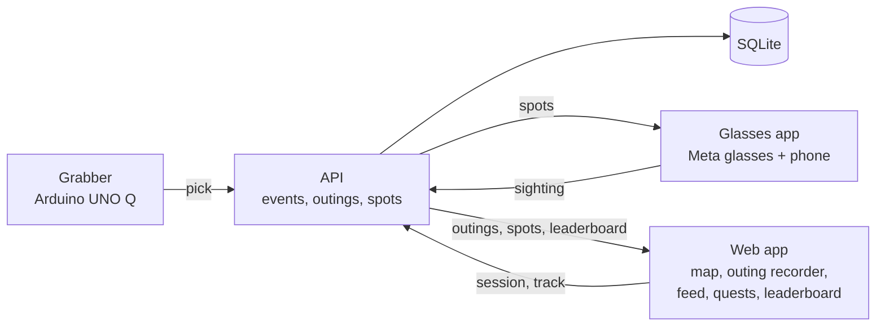

# Architecture

How Plokka is built.

Every part talks only to the API. The events and the read endpoints are in the [contract](contract/README.md).

## Modules

| Module | Folder | What it does |
|---|---|---|
| Contract | `contract/` | Event format and read endpoints |
| API | `api/` | Stores events; builds outings, spots and the leaderboard on every read |
| Simulator | `api/sim.py` | Sends made-up or recorded outings, for the demo without hardware |
| Grabber | `grabber/` | Recognises the picked item by camera and sends `pick` |
| Glasses app | `glasses/` | Streams the glasses camera to the phone, runs YOLO, sends `sighting` with the phone's location. On Android it also shows litter on the Meta Ray-Ban Display; the iOS app only detects on screen and sends nothing |
| Outing recorder | `web/` (`js/recorder.js`) | Records the outing on the map, like Strava: start, pause, finish, the GPS track. The API's `/record` page is the older fallback |
| Web app | `web/` | Map, outings, stats, quests, leaderboard, profile |

### Web app: front end and back end

The API is the back end of the web app; no second server. Points, quests and streaks are computed in the front end from what the API returns, as the contract says. Users are nicknames in `user_id`, no accounts.

Works on desktop and on the phone: below 760 px the sidebar becomes a bottom bar.

### Where a pick is

The grabber has no GPS. The API puts each pick on the route of the outing by time, so a pick is as accurate as the phone's GPS, about 5–15 m. For that, the grabber's clock must be in sync, and the grabber must be in the outing's `device_ids`.
