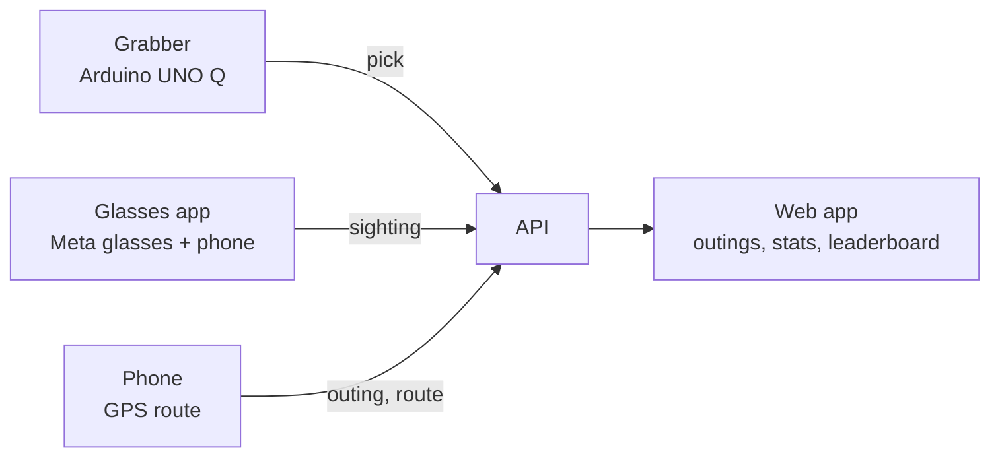

# Plokka

### ▶️ [Watch the demo video on YouTube](https://www.youtube.com/watch?v=fIfEOPphNNs)

Built at [Junction 2026](https://2026.hackjunction.com), 13–15 November 2026, Espoo.

Strava for [plogging](https://en.wikipedia.org/wiki/Plogging), that is, picking up litter while you walk or run. Scouts' Meta glasses pin litter on the map; ploggers pick it up and clear it. Any device can report a pick; ours is a grabber that counts every item and, like the glasses, tells its type by camera. The phone records the route, and every outing becomes stats to share and compete on.

## How it works

Each part talks only to the API, never to another part, through the [contract](contract/README.md). The grabber knows nothing about GPS: the API puts every pick on the route of the outing by its time.

## Parts

| Folder | What it does |
|---|---|
| [contract/](contract/README.md) | The event format that all parts share |
| [api/](api/README.md) | Receives events, puts picks on the route, computes stats |
| [web/](web/README.md) | What people see: outings, stats, leaderboard |
| [grabber/](grabber/README.md) | Recognises a pick and, with its camera, the type of litter, on the Arduino UNO Q |
| [glasses/](glasses/README.md) | Spots litter and recognises its type with Meta glasses |

Each part has its own README with how it works and how to run it: read it before you dig into the code.

## Run it

Without hardware, the [simulator](api/README.md#simulator) in `api/` sends made-up outings.

## Team

[@epustozerov](https://github.com/epustozerov), [@gdonalddak](https://github.com/gdonalddak), [@Trave11er](https://github.com/Trave11er), [@alexGitSpace](https://github.com/alexGitSpace)

## License

[MIT](LICENSE)
