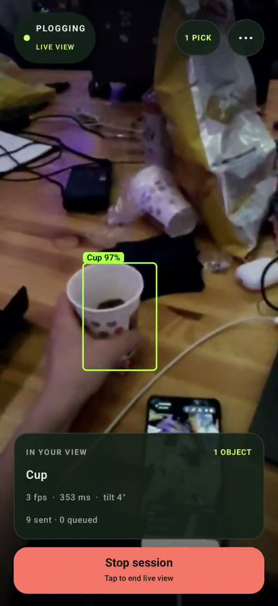
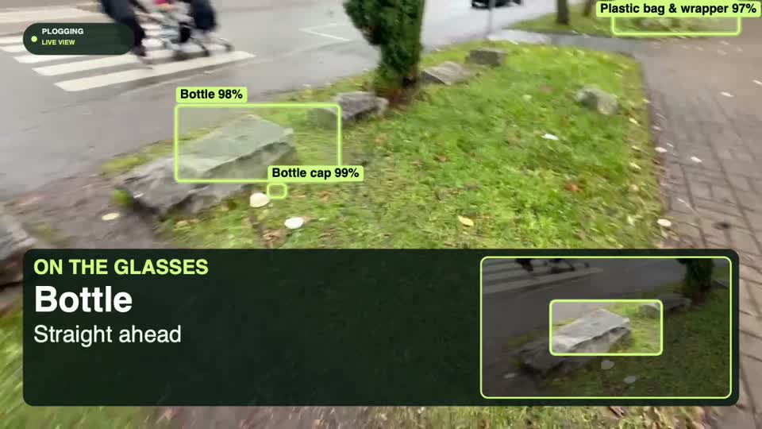

# glasses

<p align="center">
  
  &nbsp;
  
</p>

<p align="center"><em>Left: the phone, live from real glasses, spotting a cup in someone's hand. Right: the card the glasses display shows, here on the demo video.</em></p>

<p align="center"><strong>▶️ <a href="https://www.youtube.com/watch?v=fIfEOPphNNs">Watch the whole thing in action on YouTube</a></strong></p>

You walk around in your Meta glasses, the phone in your pocket watches the camera stream, and every time a bottle, a can or a wrapper shows up, it gets noticed, pinned on the map and, if you pick it up, counted. That's the whole idea.

The detecting runs on the phone itself. Every frame from the glasses goes through a small YOLO model trained on litter, no cloud needed. The cloud only gets the result: a `sighting` for each piece of litter ([contract](../contract/README.md)).

## What it does

- **Spots litter.** Bottles, cans, cups, cartons, wrappers, cigarette butts and more, at about 3 frames a second from the real glasses.
- **Tells you on the lenses.** One short card on the glasses display: what it found, which way to turn, and a little picture with the thing outlined. Short enough to read at a glance and not make you walk into a lamp post.
- **Counts your picks.** When you bend down to litter you just saw, or your own hand closes on it (MediaPipe tracks the hand), that's a pick.
- **Asks for a second opinion.** If YOLO isn't sure what you just picked up, one close-up goes to Gemini through the API, and it names the thing.
- **Keeps you company.** A calm ElevenLabs voice says hi when you start, says something nice when you pick, and now and then reminds you that you're doing a good thing. It falls back to a beep without a key.
- **Pins it on the map.** Each sighting carries the phone's location, so other people can see where the litter is.
- **Records the whole thing.** The record button saves the glasses camera with the card on top to `Movies/Plogging`, since the glasses don't send their own screen back.

## Two apps

There are two of them, iOS and Android, with the same screen, the same four sources and the same file names, so a change in one is easy to repeat in the other. They share no code.

The Android app is the one we use in the demo, and the one with all the bells and whistles above. The iOS app does the detecting and the HUD, but not the picks, voice, recognition or sightings.

| Path | What it is |
|---|---|
| `android/` | The Android app: one screen in Jetpack Compose. `GlassesSource.kt` is the only file that talks to the Meta SDK |
| `App/` | The iOS app: one screen in SwiftUI. `GlassesSource.swift` is the only file that talks to the Meta SDK |
| `Detection/` | A Swift package with the iOS detector. It also builds on a Mac, with a command-line tool to try a model on a video |
| `project.yml` | The [XcodeGen](https://github.com/yonaskolb/XcodeGen) spec that `PloggingGlasses.xcodeproj` is generated from |
| `scripts/` | `setup.sh` gets the models and the demo video; `export_model.py` converts YOLO weights for both apps |
| `docs/` | The pictures in this README |

## No glasses? No problem

The Meta SDK can pretend there's a pair of glasses that plays a video or shows the phone camera. So you can try everything on a simulator, an emulator or a plain phone. Pick a source at the top of the screen and press Start.

| Source | Needs | What it shows |
|---|---|---|
| Simulated glasses: demo video | Simulator, emulator or phone | The whole Meta SDK path (session, camera, stream) on a video |
| Simulated glasses: phone camera | Phone, or the Android emulator | The same path on the live back camera |
| Demo video, no Meta SDK | Simulator, emulator or phone | Just the detector, for when the SDK gets in the way |
| Meta glasses | Phone and glasses | The real thing |

Real glasses need a real phone: simulators and emulators have no Bluetooth and no Meta AI app.

## Setup

You need a Mac with Python 3, plus Xcode 26.4 or newer for iOS, or JDK 17 or newer and the Android SDK for Android. Then:

```bash
glasses/scripts/setup.sh
```

It grabs everything that isn't in git:

- the TACO YOLO11s model (litter classes like `Bottle`, `Can`, `Cigarette` and `Plastic bag & wrapper`), as `App/Resources/Detector.mlpackage` for iOS and `android/app/src/main/assets/detector.onnx` for Android;
- `demo.mp4`, bottles, cans and a carton on a canal bank, for both;
- `android/app/src/main/assets/hand_landmarker.task`, the hand model for counting picks on Android.

## Android

Open `glasses/android` in Android Studio, or build from the terminal with a phone or emulator attached:

```bash
cd glasses/android && ./gradlew installDebug
```

If Gradle can't find the Android SDK, put its path into `glasses/android/local.properties` as `sdk.dir=/path/to/Android/sdk`.

For the calm voice, give the build an ElevenLabs key, either as the `ELEVENLABS_API_KEY` environment variable or as `elevenlabs.api.key=...` in `local.properties` (which is not in git, keep it that way). Without a key you get a beep, which is less soothing but works.

With real glasses:

1. Turn on **Developer Mode** in the Meta AI app (see below; it's a bit hidden).
2. Run the app on the phone and allow **Nearby devices** when Android asks.
3. Tap **Connect glasses** and confirm in Meta AI. It sends you back to the app.
4. Put the glasses on. The live view starts by itself. The first time, Meta AI asks to allow the camera.

The app also asks for your location, which goes into each `sighting`. Say no and the detector still runs, it just can't pin anything. Sightings go to `https://plogging-api.up.railway.app` unless you change the address in the HUD menu (the `...` button).

On an emulator, set a location in the emulator controls, or the app will wait for GPS forever. And give it some cores, or detection crawls: `emulator -avd <name> -cores 4`.

## iOS

```bash
open glasses/PloggingGlasses.xcodeproj
```

The first build downloads the Meta SDK as a Swift package. Choose an iPhone simulator and press Run.

With real glasses:

1. In Xcode, select the PloggingGlasses target, then Signing & Capabilities: choose your team and change the bundle identifier to your own.
2. Pair the glasses with the Meta AI app and turn on **Developer Mode** (see below).
3. Run the app on the iPhone, choose **Meta glasses** and tap **Connect glasses**. Meta AI opens: confirm, and it returns to the app.
4. Put the glasses on and press **Start**. The first time, Meta AI asks to allow the camera.

Fair warning: we've only run the iOS app in the simulator so far. The real-glasses path is tested on Android.

## Developer Mode, and when it doesn't connect

Developer Mode is hidden like a cheat code: open the Meta AI app, go to Settings, then App Info, and tap the **App version** number five times. A switch appears: turn it on. It can quietly turn itself off after a firmware update, so check it first when things stop working.

Without it, **Connect glasses** ends in Meta AI with "Error opening link". That's Meta AI refusing to register an app that has no app ID.

If the stream is stuck on "Looking for glasses": check Developer Mode, check Bluetooth, and make sure the glasses are unfolded and actually on your head. A tap on the side of the glasses pauses and resumes the stream, so you may have paused it by accident.

Developer Mode needs no keys. To share the app through a release channel, create a project in the [Wearables Developer Center](https://wearables.developer.meta.com/) and pass its values from outside git: on iOS as the Xcode build settings `META_APP_ID` and `CLIENT_TOKEN`, on Android as `./gradlew installDebug -Pmwdat_application_id=... -Pmwdat_client_token=...`.

## Trying the model on a Mac

No phone, no glasses, no Xcode, just the Command Line Tools:

```bash
cd glasses/Detection
swift run detect-video --model ../App/Resources/Detector.mlpackage --video ../App/Resources/demo.mp4 --annotate frame.png
```

It prints what it finds in each frame and saves the busiest frame, with boxes, to `frame.png`. Use `--output glasses.mp4` instead to get the whole video with the glasses card drawn on every frame. That's how the canal picture at the top was made.

## Swapping the model

```bash
cd glasses
.venv/bin/python scripts/export_model.py path/to/best.pt
```

This replaces the model in both apps, no code changes. Add `--only ios` or `--only android` for just one. It needs to be a YOLO detection model that Ultralytics can export with `nms=True`.

## Things we learned the hard way

- **Licence.** Ultralytics YOLO and its weights are AGPL-3.0, so the models are made by a script and never committed to this MIT repo. Check the licence before shipping anything beyond the hackathon demo.
- **Low resolution is fine.** The glasses stream 360x640 at 24 frames a second over Bluetooth. That's plenty for the detector.
- **Don't stretch the frame.** It goes into the square model input with bars on the sides. Stretched, YOLO thinks bottles are toothbrushes. Really.
- **Same frame, different confidence.** iOS says about 100% on the demo bottles, Android about 90%. Boxes and classes agree; Core ML and ONNX just score differently.
- **iOS needs code signing,** also in the simulator. Build with `CODE_SIGNING_ALLOWED=NO` and the Meta SDK fails to configure and the app crashes at launch.
- **iOS console spam.** "Class ... is implemented in both MWDATMockDevice and MWDATCamera" comes from inside the Meta SDK. Ignore it.
- **Android speed.** ONNX Runtime on the CPU takes about 70 ms a frame on a four-core emulator. We tried XNNPACK; it was twice as slow.
- **The demo video** is [bottles, cans and a carton on a canal bank](https://www.pexels.com/video/wastes-on-the-canal-4855724/) from Pexels, under the Pexels License.

## Credits

Built at Junction 2026. OpenAI Codex helped with the Android full-screen viewfinder, the orientation-aware HUD and the Meta glasses startup flow.
