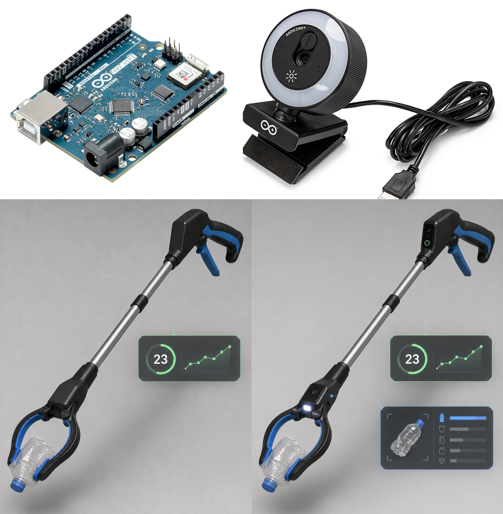
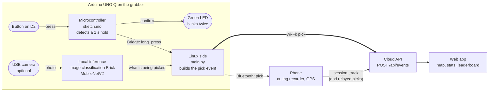

# grabber

## Why this project

This project answers the Arduino challenge **The Green European Renaissance –
Make Europe Green through Edge AI using Arduino.** The challenge asks teams to use Edge AI and the Arduino UNO Q to
create local solutions for a greener Europe, solutions that do not depend on
governments or big companies.

Our answer is a grabber that counts what is picked up during a clean-up and
classifies it on the board itself, with no cloud AI.

As part of the challenge we built a working prototype: picking up an object
triggers an event, and the board classifies the object with its camera.

Top: the parts, an Arduino board and a USB camera. Bottom left: the
grabber as an event notifier, which counts picks. Bottom right: the same
grabber with a camera, which also classifies what is being picked.

## The idea

**A mechanical event notifier.** An Arduino with Bluetooth or Wi-Fi turns a
mechanical action into an event on a phone or in the cloud. Here the action is
picking something up: closing the grabber presses a button. This needs no
camera and no Linux, so a small board is enough, for example an Arduino Nano 33
BLE Sense or an UNO R4 WiFi.

**Add a camera to know what it was.** With a camera, the board can also
classify what is being picked. The classification runs locally on the board,
for example on an UNO Q, so only the label is sent, not the photo.

## This build

This build uses an UNO Q for both levels. A button on the grabber detects a
pick. The board sends it as a `pick` event ([contract](../contract/README.md))
over Wi-Fi or Bluetooth, to the cloud API or to the phone. A camera can be added to classify what is being picked on
the board.

Thick arrow: the path built today. Dashed: optional or not built yet.

## How an event travels

1. **Detect.** The microcontroller samples the button every 10 ms. A hold of
   1 s is one event. The LED blinks at once, with no need for Linux or a
   network.
2. **Hand over.** The sketch notifies the Linux side through the Bridge
   (`long_press`). Linux stamps the event with its network-synced clock: the
   microcontroller has no real clock.
3. **Classify (optional).** With a camera, Linux takes a photo and classifies
   what is being picked on the board. Only the label leaves the board, not the
   photo.
4. **Send.** Linux posts the `pick` event.
   - **Wi-Fi to the cloud:** straight to the API. Needs a network the board
     knows, such as the phone's hotspot.
   - **Bluetooth to the phone:** the phone relays the event to the API over
     mobile data. No Wi-Fi network is needed outdoors.
5. **Place.** The grabber has no GPS. The API puts the pick on the phone's
   route by its time.

## What is built today

| Part | Status |
|---|---|
| Button, 1 s hold, LED blink | Built |
| Bridge from the sketch to Linux | Built |
| Wi-Fi to the cloud API | Built |
| Camera and local inference | Built, but not optional yet: the app stops without a camera, and a pick is sent only when the photo shows a bottle or a banana |
| Bluetooth to the phone | Not built. The board has the radio; the phone would need an app that receives picks and relays them |

## Building and running it

Wiring, Wi-Fi, the camera, deploying and reading the logs are in
[DEVELOPER.md](DEVELOPER.md).
